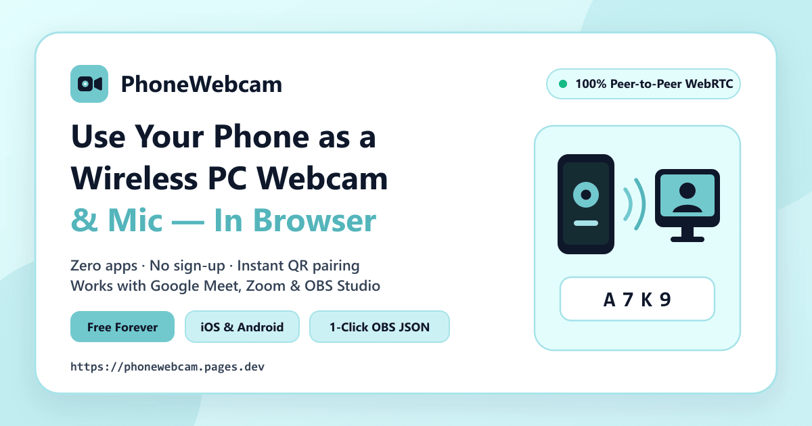
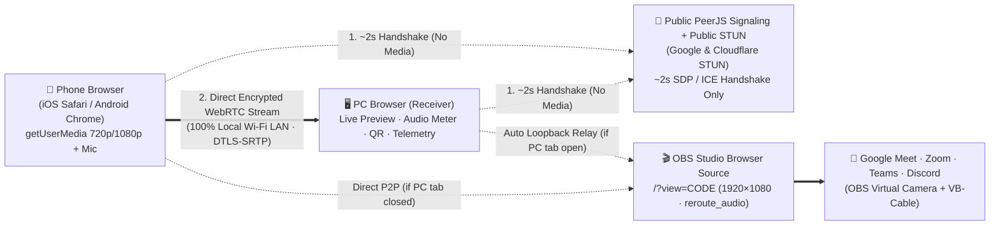

<div align="center">

<a href="https://phonewebcam.pages.dev/">
  
</a>

<br />
<br />

# PhoneWebcam

**Turn any iPhone or Android smartphone into a crisp wireless PC webcam & microphone — 100% inside your browser.**

*Zero mobile apps · Zero PC drivers · Zero accounts · Zero server costs · 100% private peer-to-peer WebRTC*

<br />

[](https://phonewebcam.pages.dev/)
[](https://astro.build)
[](https://webrtc.org/)
[](#-internationalization-8-languages)
[](./LICENSE)

<br />

[Live Demo](https://phonewebcam.pages.dev/) ·
[Features](#-key-features) ·
[How It Works](#-architecture) ·
[OBS Studio 1-Click](#-obs-studio-1-click-setup--clean-view) ·
[Local Setup](#-local-development) ·
[Deploy](#-deploy-to-cloudflare-pages) ·
[Privacy](#-privacy--security) ·
[Hire Me](https://phonewebcam.pages.dev/hire-me)

</div>

---

## ✨ Why PhoneWebcam?

Laptop webcams struggle in low light, desktop PCs often ship with no camera or microphone at all, and most phone-webcam tools force you to install bloated mobile apps, pay to remove watermarks, or wrestle with USB drivers.

**PhoneWebcam** replaces all of that with a single fast web page:

| Capability | PhoneWebcam | Traditional Webcam Apps |
|---|---|---|
| **Mobile app install** | None (Safari iOS & Chrome Android) | App Store / Play Store app required |
| **Account / Sign-up** | None | Often required |
| **Video watermarks or paywalls** | None (100% free & open source) | Frequently locked behind Pro tier |
| **Cloud video servers** | None — 100% local LAN P2P WebRTC | Often cloud-relayed |
| **OBS Studio integration** | Dynamic 1-click `.json` Scene Collection + `?view=CODE` | Manual source configuration |
| **Audio support** | Phone mic with echo cancellation + OBS audio routing | Frequently muted or Pro-only |
| **Hosting & running cost** | **$0 / month** on Cloudflare Pages (`output: 'static'`) | Dedicated backend / relay servers |

---

## 🚀 Key Features

### 📡 100% Client-Side Peer-to-Peer WebRTC
- **Direct Local Wi-Fi Streaming:** Uses public PeerJS signaling and public Google/Cloudflare STUN servers *only* for the ~2-second SDP/ICE handshake. Once paired, 100% of DTLS-SRTP encrypted video and audio streams directly between your phone and PC over your local router.
- **Collision-Safe Pairing:** Cryptographically generates easy-to-read 4-character uppercase room codes excluding ambiguous characters (`O`, `0`, `I`, `1`), alongside an instant scannable client-side QR code.
- **Zero-Friction Short URL:** Type `phonewebcam.pages.dev/c` on any mobile browser to jump directly into Phone Camera mode.

### 🎥 Studio-Grade Controls & Live Telemetry
- **PC Receiver Controls:** Real-time Web Audio `AnalyserNode` animated microphone level meter, live video resolution badge (`1280×720` / `1920×1080`), live WebRTC `getStats()` round-trip latency (`ms`), Mirror toggle, default-muted local monitor (prevents room feedback/echo), and Fullscreen view.
- **Phone Sender Controls:** Instant `?mode=phone&code=XXXX` auto-fill or 4 tactile code input boxes, Front/Back camera toggle, `720p` / `1080p` quality selector, live `RTCRtpSender.replaceTrack()` camera switching without dropping the stream, Mic mute/unmute synced via DataChannel, Rear Flash/Torch toggle (when supported by hardware), and Screen Wake Lock API (`navigator.wakeLock`) with automatic re-acquire on tab focus.
- **iOS Safari & Android Chrome Ready:** `getUserMedia()` invokes directly inside the user-gesture handler with `{ echoCancellation: true, noiseSuppression: true, autoGainControl: true }`, plus graceful error recovery with 1-click Reconnect.

### 🎬 OBS Studio 1-Click Setup & Clean View
- **Dynamic 1-Click OBS `.json` Export:** Generates and downloads a valid OBS Studio Scene Collection (`PhoneWebcam-OBS-CODE.json`) pre-configured with a `1920×1080` `browser_source` pointing to `https://phonewebcam.pages.dev/?view=CODE` with **Control audio via OBS** (`reroute_audio: true`) already enabled.
- **Zero-Chrome Clean View (`?view=CODE`):** Renders a pure `100vw × 100vh` `#000000` canvas with an auto-connecting unmuted `<video>` element (`object-fit: cover`).
- **Automatic Dual-Mode Attachment:** Works seamlessly whether the PC homepage tab is **closed** (OBS directly claims the room) or **left open** (OBS automatically attaches via local loopback WebRTC relay from the PC tab).

### 🎨 Minimal UI, Theming & Accessibility
- **Light-First Cyan Design System:** Clean `#E3FDFD` / `#CBF1F5` / `#71C9CE` light palette paired with a crisp `#0B161A` / `#162C33` dark mode persisted in `localStorage` with an inline `<head>` anti-FOUT boot script.
- **WCAG AAA Contrast & Screen-Reader Support:** Every Light & Dark color pair exceeds `7.4:1` contrast, all interactive controls carry accessible labels and visible `:focus-visible` rings, decorative SVGs are `aria-hidden="true"`, and live connection/copy updates announce via `aria-live="polite"`.
- **Responsive Down to `320px`:** Single-row icon-only mobile/tablet navbar, fluid touch targets, and `prefers-reduced-motion` support.

### 🌍 Internationalization (8 Languages)
Dynamic client-side language switcher persisted to `localStorage` that updates both static Astro HTML and hydrated React islands in real time while preserving clean canonical English SEO URLs:

`English (EN)` · `Español (ES)` · `Português (PT)` · `Deutsch (DE)` · `Français (FR)` · `日本語 (JA)` · `简体中文 (ZH)` · `Русский (RU)`

---

## 🧭 Quick Start & URL Routes

| URL / Parameter | Purpose |
|---|---|
| `/` | Main PhoneWebcam app (auto-detects PC vs. Mobile) |
| `/?mode=phone&code=A7K9` | Opens Phone Camera mode with room code `A7K9` pre-filled (encoded in QR) |
| `/?view=A7K9` | Full-viewport chrome-free black canvas for OBS Browser Source |
| `/c` or `/phone` | Short 302 redirect to `/?mode=phone` for effortless phone typing |
| `/google-meet` | Step-by-step setup guide for Google Meet (Chrome & Edge) |
| `/zoom` | Setup guide for Zoom Desktop/Web, Microsoft Teams, Discord & VB-Cable |
| `/obs` | Streamer guide for OBS 1-Click JSON & Clean Browser Source |
| `/how-to-use` | Complete pairing reference, permission troubleshooting & Wi-Fi tips |
| `/privacy` | Transparent peer-to-peer privacy policy |
| `/hire-me` | Freelance availability & direct contact |

---

## 🏗️ Architecture



```text
+-----------------------------------+       ~2s SDP/ICE Handshake Only       +------------------------------------+
|  Phone (iOS Safari / Chrome)      | -------------------------------------> |  Public PeerJS + Public STUN       |
|  Camera (720p/1080p) + Mic        | <------------------------------------- |  (Never sees video/audio frames)   |
+-----------------------------------+                                        +------------------------------------+
                 ||
                 ||  100% Direct Peer-to-Peer Encrypted WebRTC (Local Wi-Fi LAN)
                 \/
+-----------------------------------+     1-Click JSON / ?view=CODE     +-----------------------------------------+
|  PC Browser (Receiver)            | --------------------------------> |  OBS Studio -> Virtual Camera + VB-Cable|
|  Live Preview + Web Audio Meter   |                                   |  (Google Meet, Zoom, Teams, Discord)    |
+-----------------------------------+                                   +-----------------------------------------+
```

---

## 🛠️ Tech Stack

| Layer | Technology |
|---|---|
| **Framework** | [Astro 5](https://astro.build) (`output: 'static'`, Islands Architecture — zero React JS shipped on static SEO pages) |
| **Interactive Island** | [React 19](https://react.dev) + TypeScript (`strict`) |
| **Styling** | [Tailwind CSS 3](https://tailwindcss.com) + CSS Custom Properties |
| **WebRTC & Media** | [PeerJS](https://peerjs.com), WebRTC `RTCPeerConnection` (`getStats`, `replaceTrack`), Web Audio `AnalyserNode`, Screen Wake Lock API |
| **QR Generation** | [`qrcode`](https://www.npmjs.com/package/qrcode) (100% client-side) |
| **Hosting** | [Cloudflare Pages](https://pages.cloudflare.com/) (`_headers`, `_redirects`, flat `sitemap.xml`) |

---

## 📂 Project Structure

```text
phonewebcam/
├── public/
│   ├── _headers                # Security, WebRTC Permissions-Policy & immutable asset caching
│   ├── _redirects              # Short aliases (/c, /phone -> /?mode=phone)
│   ├── favicon.svg             # Vector brand mark
│   ├── og-image.png            # 1200×630 Open Graph / Twitter social preview card
│   └── robots.txt              # Crawler rules pointing to flat sitemap.xml
├── src/
│   ├── components/
│   │   ├── AudioMeter.tsx      # Real-time Web Audio API AnalyserNode mic meter
│   │   ├── Breadcrumbs.astro   # Accessible subpage breadcrumbs (omitted on /)
│   │   ├── Footer.astro        # Responsive minimal footer
│   │   ├── Icons.tsx           # Zero-CLS crisp SVG icon library (explicit w/h)
│   │   ├── Navbar.astro        # Desktop + single-row icon-only mobile/tablet navbar
│   │   ├── ObsCleanView.tsx    # Full-viewport 100vw×100vh ?view=CODE receiver & relay
│   │   ├── SEOHead.astro       # Title/description length guardrails, OG/Twitter & JSON-LD
│   │   └── WebcamTool.tsx      # Core WebRTC Astro Island (PC Receiver + Phone Sender)
│   ├── i18n/
│   │   ├── index.ts            # Typed i18n runtime + DOM & React sync store
│   │   └── {en,es,pt,de,fr,ja,zh,ru}.json
│   ├── layouts/
│   │   └── BaseLayout.astro    # Anti-FOUT theme/OBS boot script, GTM/GA4 async & layout shell
│   ├── lib/
│   │   ├── obsConfig.ts        # Dynamic OBS Studio Scene Collection (.json) builder
│   │   ├── roomCode.ts         # Crypto 4-char code generator & PeerJS ID helpers
│   │   ├── seo.ts              # WebApplication, FAQPage, HowTo, BreadcrumbList & Person schemas
│   │   └── webrtc.ts           # STUN config, media constraints, latency & error mapping
│   ├── pages/
│   │   ├── index.astro         # Full-viewport hero + live tool + app connect & FAQ
│   │   ├── google-meet.astro   # Google Meet setup guide
│   │   ├── zoom.astro          # Zoom, Microsoft Teams & Discord guide
│   │   ├── obs.astro           # OBS Studio Browser Source & 1-Click JSON guide
│   │   ├── how-to-use.astro    # Complete pairing & troubleshooting documentation
│   │   ├── privacy.astro       # Plain-English P2P privacy policy
│   │   ├── hire-me.astro       # Freelance portfolio & 1-click Copy Email
│   │   └── sitemap.xml.ts      # GSC-safe flat XML sitemap endpoint
│   └── styles/
│       └── global.css          # Theme tokens, animations, prefers-reduced-motion & OBS mode
├── astro.config.mjs
├── tailwind.config.mjs
├── tsconfig.json
├── package.json
└── LICENSE
```

---

## 💻 Local Development

**Prerequisites:** Node.js `18+` (verified on Node `24`) and `npm`.

```bash
# 1. Clone the repository
git clone https://github.com/Kishara007/phonewebcam.git
cd phonewebcam

# 2. Install dependencies
npm install

# 3. Start the Astro development server (http://localhost:4321)
npm run dev

# 4. Run TypeScript checks & build static output to dist/
npm run typecheck
npm run build

# 5. Preview the compiled static production build locally
npm run preview
```

> **Tip for testing with a real phone locally:** Mobile browsers (iOS Safari & Android Chrome) require a secure HTTPS origin (`window.isSecureContext === true`) to unlock `navigator.mediaDevices.getUserMedia()`. Because the desktop QR code points to `https://phonewebcam.pages.dev/?mode=phone&code=XXXX`, you can scan it directly during local `npm run dev` testing and pair seamlessly over the same signaling broker with your `localhost` PC receiver!

---

## ☁️ Deploy to Cloudflare Pages

PhoneWebcam compiles to pure static HTML, CSS, and client islands (`output: 'static'`), so hosting on **Cloudflare Pages** is completely free with global edge caching:

1. Fork or push this repository to GitHub.
2. In the Cloudflare Dashboard, navigate to **Workers & Pages → Create → Pages → Connect to Git**.
3. Select the repository and enter these exact build settings:

| Setting | Value |
|---|---|
| **Framework preset** | `Astro` |
| **Build command** | `npm run build` |
| **Build output directory** | `dist` |
| **Root directory** | `/` |

4. Click **Save and Deploy**.

Cloudflare Pages automatically applies:
- `public/_headers` — enforces `X-Content-Type-Options: nosniff`, `X-Frame-Options: SAMEORIGIN`, `Referrer-Policy`, WebRTC `Permissions-Policy: camera=(self), microphone=(self), display-capture=(self), fullscreen=(self), screen-wake-lock=(self)`, and 1-year `immutable` caching on `/_astro/*`.
- `public/_redirects` — maps `/c` and `/phone` to `/?mode=phone` (`302`).
- `dist/sitemap.xml` — flat, Google Search Console–friendly XML sitemap (no `sitemap-index.xml`) referenced by `public/robots.txt`.
- `functions/api/ice-servers.ts` — optional edge endpoint serving dynamic STUN + TURN credentials so **iPhones on 4G/5G cellular data, different Wi-Fi networks, iCloud Private Relay, or strict routers** connect seamlessly while same-Wi-Fi devices continue using direct local LAN P2P (0 TURN bytes).

### Enable Cross-Network & iPhone 4G/5G Support (3-Provider Smart TURN Fallback)

Same-Wi-Fi connections work out of the box with zero configuration (**Stage 1 STUN-only**, `0` TURN bytes used). To also support **different networks (iPhone 4G/5G cellular ↔ PC broadband)**, **iCloud Private Relay**, and **Windows PCs without Bonjour mDNS**, configure any or all 3 free TURN providers in **Cloudflare Pages → Settings → Environment variables** (zero secrets are ever committed to Git; for local Wrangler testing copy `.dev.vars.example` to gitignored `.dev.vars`):

`/api/ice-servers?mode=relay` activates **only one provider at a time** (keeping iOS Safari ICE fast) in strict priority order and hops automatically (`?skip=metered`, etc.) if a provider fails or reaches its free quota:

| Priority | Provider | Environment Variables | Notes |
|---|---|---|---|
| **1** | **Metered** ([metered.ca](https://www.metered.ca/)) | `METERED_APP_NAME`, `METERED_API_KEY` *(or static `METERED_USERNAME`, `METERED_PASSWORD`)* | Fetches expiring dynamic credentials with a 2s edge timeout; falls through automatically if quota is exceeded. |
| **2** | **Turnix** ([turnix.io](https://turnix.io/)) | `TURNIX_API_TOKEN` **or** `TURNIX_USERNAME`, `TURNIX_PASSWORD`, optional `TURNIX_URL` *(defaults to `turn:turn.turnix.io:3478`)* | Supports both Turnix dynamic API token (`POST /api/v1/credentials/ice`) and static TURN credentials. |
| **3** | **ExpressTURN** ([expressturn.com](https://www.expressturn.com/)) | `EXPRESSTURN_USERNAME`, `EXPRESSTURN_PASSWORD` | Serves `turn:free.expressturn.com:3478` (UDP & TCP) + `turns:free.expressturn.com:443?transport=tcp`. |

If no TURN variables are set (or all configured providers are temporarily exhausted), `/api/ice-servers` safely returns STUN-only (`hasTurn: false`, `provider: "stun-only"`) and the UI gracefully directs users to connect on the same Wi-Fi for unlimited direct P2P streaming.

---

## 🔒 Privacy & Security

- **Zero video/audio servers:** 100% of media streams travel peer-to-peer between your phone and PC encrypted via WebRTC (`DTLS-SRTP`). Nothing is uploaded, recorded, or stored.
- **Minimal ephemeral signaling:** Random 4-character room codes exist only in memory while your tab stays open and expire immediately on refresh or close.
- **Minimal local storage:** Only `phonewebcam-theme` (Light/Dark) and `phonewebcam-lang` (interface language) are saved in `localStorage`.
- **Auditable source code:** Every line of client-side WebRTC and UI code is open source in this repository.

Read the full [Privacy Policy](https://phonewebcam.pages.dev/privacy).

---

## 🤝 Contributing

Contributions, bug reports, and translation refinements are welcome!

1. Fork the repository and create a feature branch (`git checkout -b feat/your-improvement`).
2. Keep `npm run typecheck` and `npm run build` passing with zero errors (note that `SEOHead.astro` validates 50–60 char titles and 130–155 char descriptions at build time).
3. If adding or updating UI copy, keep all 8 files in `src/i18n/` in sync.
4. Open a pull request describing your change clearly.

---

## ☕ Support & Hire the Developer

Built with care by **Kishara Dilshan**.

- **Support PhoneWebcam:** If this free tool saved a meeting or upgraded your stream, consider buying me a coffee on Gumroad:  
  [](https://kisharadilshan.gumroad.com/coffee)
- **Need a Custom Web App or Client-Side Tool?** I'm available for freelance projects specializing in ultra-fast Astro/React/Next.js web apps, zero-server WebRTC/WASM utilities, technical SEO, and high-converting UI/UX:  
  👉 **[Hire Me](https://phonewebcam.pages.dev/hire-me)** · 📩 **kisharadilshan007@gmail.com**

---

## 📄 License

Distributed under the **MIT License** — Copyright © 2026 Kishara Dilshan. See [LICENSE](./LICENSE) for the full text.
