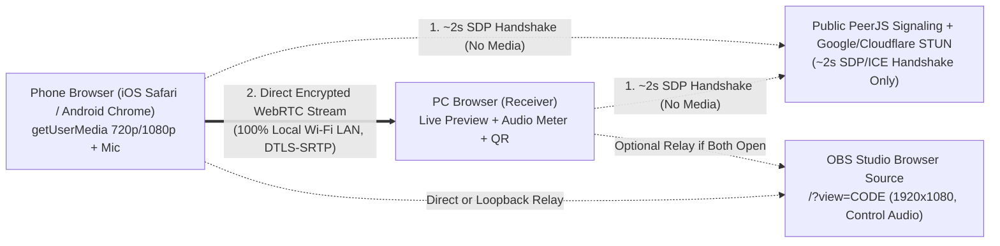

# PhoneWebcam

**Turn your iPhone or Android smartphone into a wireless HD webcam and microphone on your PC — directly in your browser.**

[](https://phonewebcam.pages.dev/)
[](./LICENSE)
[](https://astro.build)

**Live Demo:** [https://phonewebcam.pages.dev/](https://phonewebcam.pages.dev/)

---

## Highlights

- **100% Client-Side Peer-to-Peer WebRTC** — No custom backend server, no database, no user accounts, and no cloud video relay servers ($0 server costs).
- **Zero Phone Apps Required** — Works natively in Safari (iOS) and Chrome (Android) over HTTPS.
- **Instant QR & 4-Character Pairing** — Collision-safe uppercase codes (excluding `O`, `0`, `I`, `1`) with 1-click Copy & Refresh, plus short `/c` mobile redirect.
- **1-Click OBS Studio Scene Collection (`.json`)** — Dynamically generates a `1920×1080` Browser Source pointing to `/?view=CODE` with `Control audio via OBS` (`reroute_audio: true`) pre-enabled.
- **Clean OBS View (`?view=CODE`)** — Zero-chrome `100vw × 100vh` pure black canvas that automatically receives the phone stream directly (or via local WebRTC relay if the PC preview tab is also open).
- **Real-Time Telemetry & Controls** — Web Audio `AnalyserNode` live mic level meter, live stream resolution & `getStats()` latency (`ms`), Mirror toggle, default-muted local monitor (prevents echo), Fullscreen, live Front/Back `replaceTrack` camera switching, Torch/Flash toggle, and Screen Wake Lock.
- **8-Language Internationalization** — Instant client-side language switcher persisted to `localStorage` (`English`, `Español`, `Português`, `Deutsch`, `Français`, `日本語`, `简体中文`, `Русский`) while keeping canonical English SEO URLs.
- **Ultra-Minimal Light & Dark Themes** — Clean Light-first cyan palette (`#E3FDFD` / `#CBF1F5` / `#71C9CE`) with anti-FOUT Dark mode (`#0B161A` / `#162C33`), WCAG AA/AAA contrast, and `prefers-reduced-motion` support.

---

## Architecture — 100% Local Peer-to-Peer WebRTC Flow



```text
+--------------------------------+          ~2s SDP/ICE Handshake Only          +----------------------------------+
|   Phone (Safari / Chrome)      | -------------------------------------------> |  Public PeerJS + Public STUN     |
|   Camera (720p/1080p) + Mic    | <------------------------------------------- |  (Never sees video/audio frames) |
+--------------------------------+                                              +----------------------------------+
               ||
               ||  100% Direct Peer-to-Peer Encrypted WebRTC (Local Wi-Fi LAN)
               \/
+--------------------------------+      1-Click JSON / ?view=CODE       +------------------------------------------+
|   PC Browser (Receiver)        | -----------------------------------> |  OBS Studio -> Virtual Camera + VB-Cable |
|   Live Preview + Mic Meter     |                                      |  (Google Meet, Zoom, Teams, Discord)     |
+--------------------------------+                                      +------------------------------------------+
```

---

## Local Development

**Requirements:** Node.js 18+ (tested with Node 24) and npm.

```bash
# 1. Clone the repository
git clone https://github.com/Kishara007/phonewebcam.git
cd phonewebcam

# 2. Install dependencies
npm install

# 3. Start local Astro dev server
npm run dev

# 4. Type-check and build static production bundle (output: dist/)
npm run typecheck
npm run build

# 5. Preview the production static build locally
npm run preview
```

> **Note for mobile testing:** iOS Safari and Android Chrome require a secure HTTPS origin (`window.isSecureContext === true`) for `navigator.mediaDevices.getUserMedia()`. When running `npm run dev` on `localhost`, scanning the on-screen QR code opens `https://phonewebcam.pages.dev/?mode=phone&code=XXXX` over HTTPS and pairs seamlessly with your local PC receiver.

---

## Deploying to Cloudflare Pages

PhoneWebcam uses Astro's `output: 'static'` mode with zero server functions, making deployment on **Cloudflare Pages** completely free and instant:

1. Push this repository to GitHub (`https://github.com/Kishara007/phonewebcam`).
2. In the Cloudflare Dashboard, open **Workers & Pages → Create → Pages → Connect to Git**.
3. Select the repository and configure:
   - **Framework preset:** `Astro`
   - **Build command:** `npm run build`
   - **Build output directory:** `dist`
4. Click **Save and Deploy**.

Cloudflare Pages automatically picks up:
- `public/_headers` — security headers, `Permissions-Policy: camera=(self), microphone=(self), screen-wake-lock=(self)`, and immutable 1-year caching for `/_astro/*`.
- `public/_redirects` — short mobile alias `/c` → `/?mode=phone` (`302`).
- `dist/sitemap.xml` — flat, Google Search Console–friendly XML sitemap (no `sitemap-index.xml`) referenced by `public/robots.txt`.

---

## Privacy

- **Zero video servers:** 100% of camera video and microphone audio streams directly peer-to-peer between your phone and PC using encrypted WebRTC (DTLS-SRTP).
- **Zero accounts or recordings:** Nothing is uploaded, recorded, or stored on any backend server.
- **Minimal local preferences:** Only your Light/Dark theme (`phonewebcam-theme`) and language selection (`phonewebcam-lang`) are stored locally in `localStorage`.

Read the full [Privacy Policy](https://phonewebcam.pages.dev/privacy).

---

## Support & Hire Me

- **Support the Developer:** If PhoneWebcam saved your meeting or upgraded your stream, you can [buy me a coffee on Gumroad](https://kisharadilshan.gumroad.com/coffee).
- **Hire Kishara Dilshan:** Need an ultra-fast Astro/React/Next.js web app, client-side WebAssembly (WASM) tool, or high-converting landing page? Visit the [Hire Me page](https://phonewebcam.pages.dev/hire-me) or email **kisharadilshan007@gmail.com**.

---

## License

Released under the **MIT License** — Copyright © 2026 Kishara Dilshan. See [LICENSE](./LICENSE) for details.
